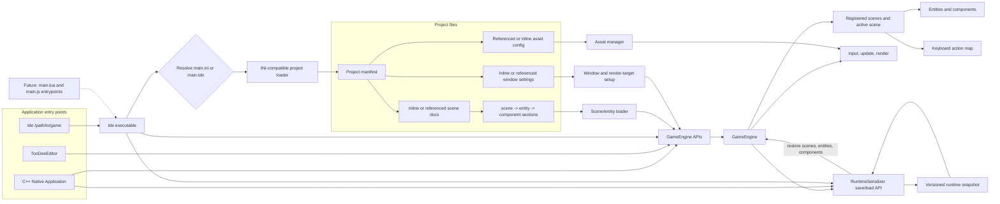

## Runtime Architecture

The diagram shows the data-driven `tde` path alongside applications that construct the engine directly.



The `tde` runtime currently accepts data-driven `main.ini` and `main.tde` entrypoints. Lua and JavaScript project entrypoints are future work. C++ Native Applications and TooDeeEditor use the engine directly.

## Project Section Shape

INI sections are flat names; dotted names encode hierarchy by convention. Singular segments match asset declarations such as `[font.default]`:

- `[scene.hello]`
- `[scene.hello.entity.my_entity]`
- `[scene.hello.entity.my_entity.component.label]`

A scene or window section can instead contain `file=...`. The referenced file repeats the same section name, and its path is resolved relative to the file containing the reference.

## Runtime Save/Load

`RuntimeSerializer` is a public engine API and does not require a project manifest. It saves registered scenes, the active scene, pause and action state, entity IDs and tags, supported built-in component data, and engine simulation/render flags. Loading validates and reconstructs a temporary scene registry before replacing runtime state. Matching C++ `Scene` subclass instances are preserved. Native function objects and scripting VM internals are not serialized.

## Entity-Component System

The engine uses a type-safe ECS architecture where entities are containers for components:

```cpp
// Create an entity and add components
auto entity = entityManager.addEntity("player");
entity->add<CTransform>(Vec2f(100, 100));
entity->add<CRectangle>(Vec2f(32, 32), sf::Color::White, sf::Color::Black, 0.f);
entity->add<CInput>();
entity->add<CAnimation>();
```

Systems query entities for the components they need and update them each tick.

## Core Components

- **CTransform**: Position and velocity
- **CCircle/CRectangle**: Visual representation
- **CAnimation**: Frame-based animations
- **CInput**: Keyboard input handling
- **CGravity**: Gravity physics
- **CBoundingBox/CBoundingCircle**: Collision detection
- **CState**: Entity state machine
- **CScore**: Score tracking
- **CLifespan**: Entity lifetime management

## Scene Management

Scenes group entities and can be switched at runtime, so each level or menu can live in
its own file. See the `tde_scenes` example.

## Game Loop

The engine operates on a standard game loop:

1. **Input**: Process user input
2. **Update**: Update game logic and physics
3. **Render**: Draw entities and UI
4. **Management**: Handle entity lifecycle

## Editor

The built-in editor is an ImGui application that runs alongside the engine for
real-time inspection and editing. It also supports `.ini` configuration files and
flexible font rendering and management.

## Source Layout

| Path | Contents |
|---|---|
| `packages/engine` | Main game engine implementation |
| `packages/core` | Core engine functionality |
| `packages/quickjs` | QuickJS-ng JavaScript runtime |
| `apps/editor` | ImGui-based editor application |
| `examples` | Example games |
| `tests` | Unit tests (GoogleTest) |

## Related

- [Examples](/guides/examples/) for ECS usage in practice
- [Configuration](/guides/configuration/) for INI files
